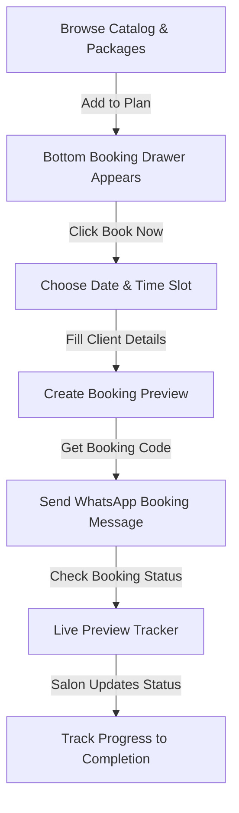
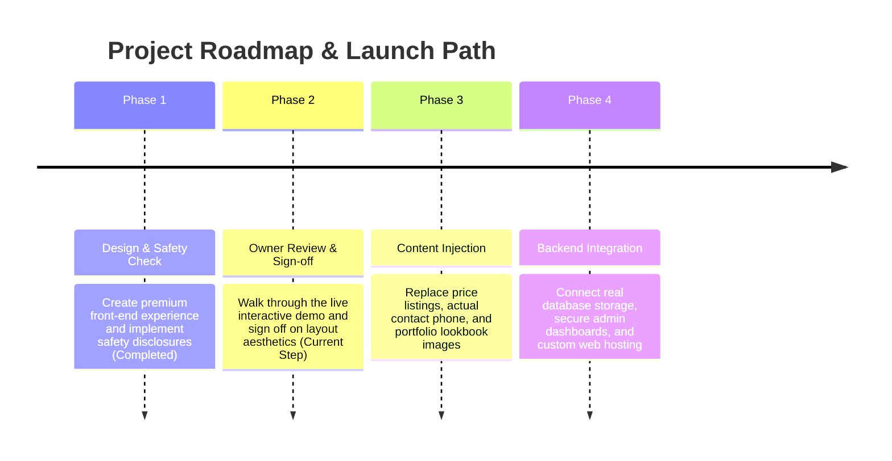

# Elevator Concept Unisex Saloon — Premium Owner Demo & Review

This document serves as the high-fidelity business demonstration and owner review sheet for the Elevator Concept Unisex Saloon digital platform. It outlines what was built, how customers interact with the platform, how you can test it on your device, and the simple launch roadmap to go live.

---

## 🎨 Premium Visual Highlights (Direct Browser Screenshots)

Below are unedited desktop and mobile views of the salon platform, designed with a luxury dark mode, champagne-gold accents, and premium glassmorphic details.

```carousel
### 📱 Mobile Home & 💻 Desktop Home View
Compare the cinematic, premium gold-themed layouts across mobile devices and desktop computers.


<!-- slide -->

<!-- slide -->
### 🛍️ Services Catalog & 🛒 Mobile Bottom Booking Drawer
Browse the categorized grooming catalog. Selecting services on mobile reveals a persistent bottom booking drawer for easy planning.


<!-- slide -->

<!-- slide -->
### 🔮 Step-by-Step Booking Wizard & Success Code
The multi-step wizard guides customers through choosing their services, selecting a date and time, entering their details, and receiving a unique booking code.


<!-- slide -->

<!-- slide -->
### 🔍 Live Preview Tracker & ⚙️ Owner Demo Admin Preview
See the booking updates in action. Updating booking status in the Owner Demo Admin Preview instantly updates the customer's live tracker timeline on this device.


<!-- slide -->

```

---

## 🛠️ What Was Built

We have engineered a premium, lightning-fast Single Page Application (SPA) designed to feel like an upscale digital store for unisex grooming and styling.

1. **Luxury Visual Theme**:
   - Built with deep black, charcoal, and shimmering champagne-gold tones.
   - Elegant interactive floating grooming elements (scissors and combs) that respond to cursor movement.
   - Smooth glassmorphism containers that feel modern and high-end.
2. **Interactive Service Catalog & Packages**:
   - Easy filters for *Barbing & Grooming*, *Hair Styling & Braids*, *Nails & Beauty*, *Facial Care*, and *Beauty Grooming*.
   - Curated service packages (like the *Fresh Look* and *Student Fresh-Up* packages) designed specifically to engage FUTA students and grooming enthusiasts.
3. **Seamless Client-Side Booking & Status Tracking**:
   - A multi-step booking wizard where customers can select dates, times, and customize self-care notes.
   - Interactive search tracker letting customers check their unique booking codes.
   - Owner Demo Admin Preview to see how managing client requests works.

---

## 👥 How Customers Will Use the Platform

The digital booking loop has been streamlined for maximum conversion and zero friction:



1. **Plan Custom Routine**: Customers explore services or select a complete package.
2. **Open Booking Wizard**: Tap "Book Now" to launch the simple scheduling forms.
3. **Receive Booking Code**: Upon finalizing, a unique booking code is generated (e.g. `ELV-4821`).
4. **Send WhatsApp Confirmation**: One tap formats and opens a pre-composed **WhatsApp booking message** so the customer can send details to your salon phone.
5. **Track Progress**: Customers can check the **Live Preview Tracker** at any time to see if their appointment is requested, confirmed, or completed.

---

## 🎭 Simple Owner Demo Script

Use this step-by-step walkthrough to present the platform or test the entire user experience yourself in under 2 minutes:

*   **Step 1: Open the Homepage**
    *   *Action*: Launch `index.html` in your web browser.
    *   *What to observe*: Look at the premium dark styling, gold glows, and the floating background comb and scissors.
*   **Step 2: Show Services & Packages**
    *   *Action*: Scroll down to the **Services Catalog** and **Curated Packages** sections. Click catalog filter tabs like "Barbing" or "Braids".
    *   *What to observe*: The cards react dynamically with smooth micro-animations.
*   **Step 3: Add Services to Plan**
    *   *Action*: Click **Add to Plan** on *Signature Haircut* and *Face Steaming & Refresh*.
    *   *What to observe*: A premium mobile-first bottom booking drawer slides up at the bottom showing how many services are in the plan and notifying that prices are confirmed at the salon.
*   **Step 4: Generate Booking Code**
    *   *Action*: Click **Book Now** on the bottom drawer. Select a date, choose `10:30 AM` as the time, type your name and phone, and click **Create Booking Preview**.
    *   *What to observe*: The wizard shows a premium confirmation layout and generates a unique booking code (e.g. `ELV-4821`).
*   **Step 5: Open WhatsApp Message**
    *   *Action*: Click **Send Booking to Salon on WhatsApp**.
    *   *What to observe*: A new browser window/app opens a WhatsApp message template containing the code, customer name, selected services, and time pre-written for the customer.
*   **Step 6: Track Booking**
    *   *Action*: Click **Track Booking Preview Status** inside the success popup.
    *   *What to observe*: You are instantly navigated to the **Live Preview Tracker** where your code search executes, showing the booking state as `Booking Requested`.
*   **Step 7: Show Owner Demo Admin Preview**
    *   *Action*: Scroll down to the **Owner Demo Admin Preview** section.
    *   *What to observe*: The dashboard shows a sample list of bookings, including the one you just created. The simulated statistics and charts are updated on this device.
    *   *Action*: Change the status of your booking code in the admin dropdown from `Booking Requested` to `Appointment Confirmed`.
    *   *Action*: Go back up to the **Live Preview Tracker** and search your code.
    *   *What to observe*: The tracker timeline instantly updates to the glowing `Appointment Confirmed` progress step!
*   **Step 8: What Becomes Real in the Backend Phase**
    *   *Explanation*: Under the hood, this demonstration saves booking previews on this device so you can test it instantly. In the backend phase, we will connect a secure database (PostgreSQL/Firebase), secure admin login, actual lookbook photo uploads, and link it to your real business WhatsApp number.

---

## 🔒 What is Preview-Only (Demo Disclosures)

To ensure high-fidelity prototyping without backend complexities, the platform uses client-side simulated technologies:

> [!NOTE]
> **Simulated Bookings on this Device**
> Bookings created during the demo are saved securely inside this browser's device storage. This allows you to experience the exact user flow without needing database servers yet.

> [!TIP]
> **No Payments or Card Credentials Required**
> Customer bookings are completely free to preview. No mock credit cards, unconfirmed billing accounts, or online bank transactions are connected.

> [!IMPORTANT]
> **Prices are placeholders until Confirmed**
> All prices in the service catalog and package modules are labeled "Confirm with salon" or "Ask on WhatsApp". This prevents pricing confusion until you provide the final price sheets.

> [!WARNING]
> **WhatsApp Number is a Placeholder**
> The booking messages are compiled using a safe placeholder number (`2348000000000`) and will redirect to your real business phone number once provided.

---

## 📋 Outstanding Details Needed for Launch

To take the platform live, please align with us to replace placeholders with your actual salon details:

| Detail Required | Purpose | Current Sandbox Value |
| :--- | :--- | :--- |
| **Official Price Lists** | Show accurate service pricing in the catalog. | `"Confirm with salon"` |
| **Active WhatsApp Number** | Route bookings directly to your business phone. | `"2348000000000"` (Placeholder) |
| **Styling Portfolio Photos** | Replace layout images with real cuts, braids, and nails. | Premium SVG vector shapes |
| **Studio Map Pin / Address** | Help customers navigate directly to your location. | FUTA Main Road address details |
| **Domain Name Choice** | The custom address where your site will live (e.g. `elevatorunisex.com`). | Local preview |

---

## 🛣️ Recommended Launch Path



All three core files (`index.html`, `style.css`, `app.js`) are fully optimized and ready for your visual inspection. We look forward to your review and feedback!
